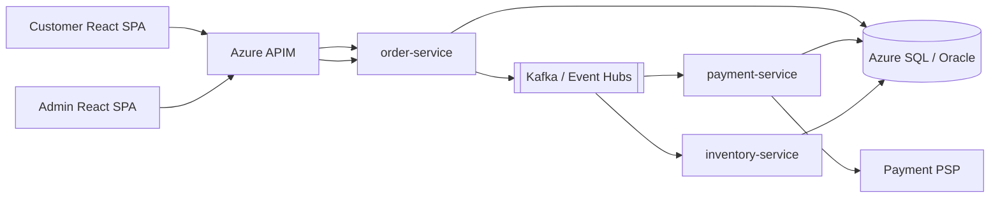
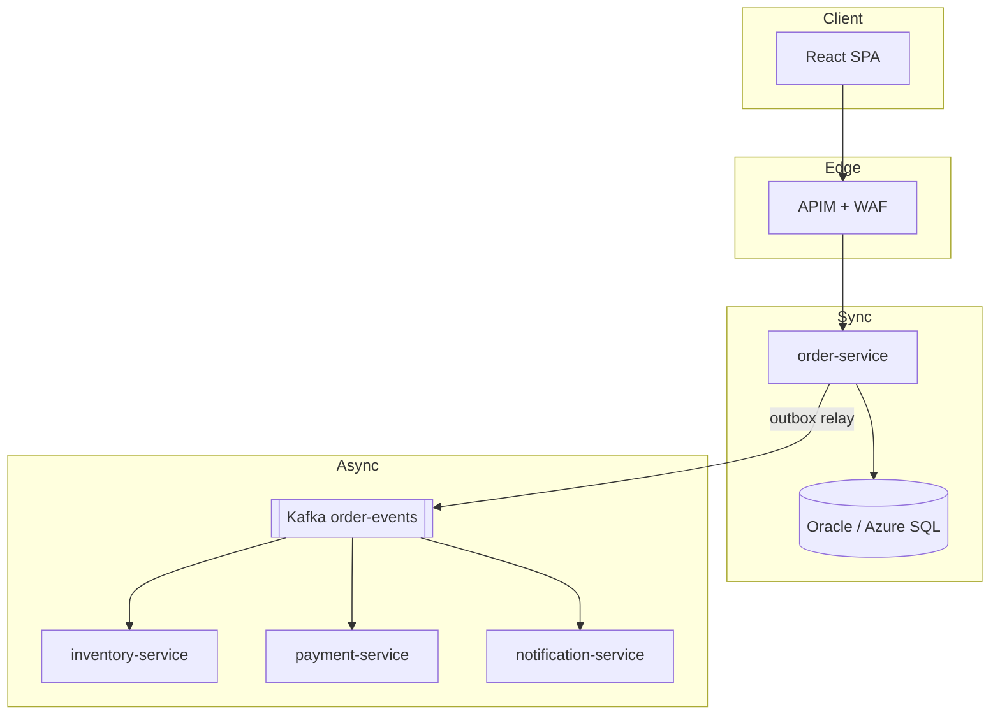
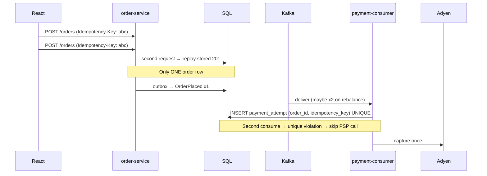
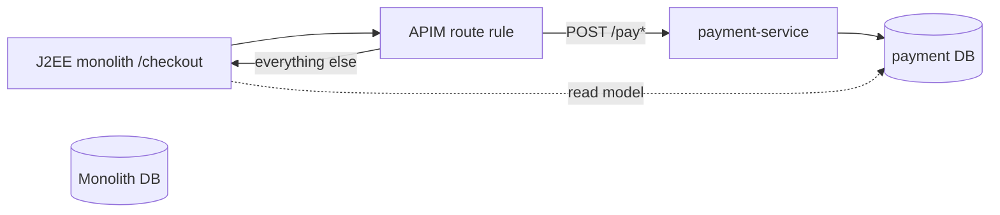
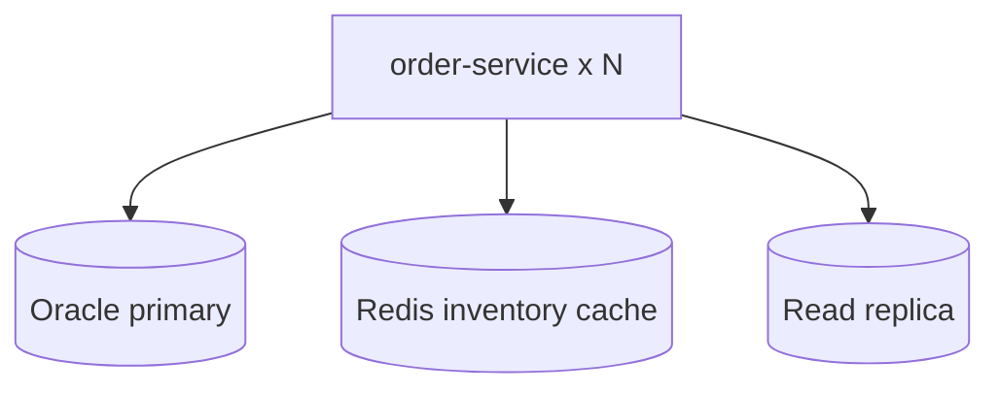

# Fullstack System Design — Practical Exercises

Work these **out loud**, with a timer. Draw on paper or a whiteboard app. Model answers below are the bar — argue with them only if you have better trade-offs.

**Structure:** Part A (Basic) · Part B (Intermediate) · Part C (Hard) · Weekend challenge  
**33 exercises** — full solutions with architecture bullets, capacity math, saga walkthroughs, and markdown diagrams.

---

# Part A — Basic (10)

---

## Exercise A1 — 90-second design opener

**Task:** Practice the first 90 seconds for any prompt. Use: Place Order at 500 QPS peak.

**Model answer — say this structure:**

1. **Users:** Customer SPA (React), admin portal (read-heavy).
2. **Happy path:** Browse → cart → `POST /orders` → pay → confirmation.
3. **NFRs:** p99 API 300ms; no double-charge; inventory must not oversell; PCI — no PAN on our servers.
4. **Scale:** 500 QPS peak checkout, 3× daily peak; 7-year order retention.
5. **Constraints:** Existing Oracle OLTP; Azure; Kafka available; 2 squads.

**Then draw boxes** — not "we'll use Kafka" first.

**Architecture bullets:**

- React SPA → APIM → `order-service` (Spring Boot, AKS)
- Azure SQL / Oracle: orders system of record
- Outbox → Kafka `order-events` (after commit)
- Payment PSP tokenization (Stripe/Adyen JS)
- BFF optional for admin aggregation

---

## Exercise A2 — Context diagram (markdown)

**Task:** Draw C4 context for Place Order in markdown (mermaid).

**Solution:**



---

## Exercise A3 — API contract: POST /orders

**Task:** Write OpenAPI essentials + idempotency. List 3 UI error mappings.

**OpenAPI sketch:**

```yaml
post:
  /orders:
    parameters:
      - in: header
        name: Idempotency-Key
        required: true
        schema: { type: string, format: uuid }
    requestBody:
      content:
        application/json:
          schema:
            type: object
            required: [cartId, shippingAddressId]
    responses:
      '201':
        description: Created
        headers:
          ETag: { schema: { type: string } }
      '200':
        description: Idempotent replay — same body as original create
      '409':
        content:
          application/problem+json:
            schema: { $ref: '#/components/schemas/ProblemDetail' }
      '412':
        description: Stale cart version
```

**React error mapping:**

| HTTP | Problem type | UI copy |
|------|--------------|---------|
| 409 | `out-of-stock` | "An item sold out — review your cart" |
| 412 | `stale-version` | "Cart updated elsewhere — refreshing…" |
| 503 | `payment-unavailable` | "Payment temporarily unavailable — try again" |

---

## Exercise A4 — Sequence: happy path Place Order

**Task:** 10-minute sequence diagram — sync create + async side effects.

```mermaid
sequenceDiagram
  participant UI as React SPA
  participant API as order-service
  participant DB as Azure SQL
  participant OB as Outbox relay
  participant K as Kafka
  participant Pay as payment-consumer

  UI->>API: POST /orders (Idempotency-Key)
  API->>DB: BEGIN; insert order PENDING; insert outbox
  DB-->>API: COMMIT
  API-->>UI: 201 { orderId, status: PENDING, etag }

  OB->>DB: poll outbox
  OB->>K: OrderPlaced (key=orderId)
  K->>Pay: consume
  Pay->>DB: insert payment_attempt; call PSP
  Pay->>K: PaymentCaptured
```

**Bullet:** `AFTER_COMMIT` listener ≠ outbox — crash between commit and publish loses event.

---

## Exercise A5 — Idempotency table design

**Task:** Schema for HTTP idempotency. Explain replay behavior.

```sql
CREATE TABLE idempotency_keys (
  key           VARCHAR(64) PRIMARY KEY,
  request_hash  VARCHAR(64) NOT NULL,
  response_code SMALLINT NOT NULL,
  response_body CLOB NOT NULL,
  created_at    TIMESTAMP WITH TIME ZONE DEFAULT SYSTIMESTAMP
);
CREATE INDEX idx_idem_created ON idempotency_keys(created_at);
```

**Behavior:**

- Same key + same hash → return stored `response_code` + body (200 or 201)
- Same key + different hash → 409 Conflict
- TTL job deletes keys older than 24h

---

## Exercise A6 — Terraform vs Helm ownership

**Task:** Fill ownership table for order platform.

| Resource | Tool | Owner team | Notes |
|----------|------|------------|-------|
| AKS cluster | Terraform | Platform | One per env |
| Node pools / Karpenter | Terraform | Platform | |
| Azure SQL server | Terraform | Platform / DBA | |
| SQL DB + firewall | Terraform | Platform | |
| APIM instance | Terraform | Platform | |
| APIM APIs/policies | Terraform or APIM repo | Platform | Rate limit, JWT |
| order-service Deployment | Helm | Order squad | |
| order-service HPA | Helm | Order squad | |
| Flyway migration Job | Helm hook / CI Job | Order squad | Before rollout |
| Key Vault | Terraform | Platform | |
| ExternalSecret | Helm | Order squad | |
| Event Hubs namespace | Terraform | Platform | |
| Kafka topics | Terraform or topic operator | Platform | |
| Prometheus rules | Helm | SRE | |

**Rule:** TF = slow-changing infra; Helm = app lifecycle (many deploys/week).

---

## Exercise A7 — Four alerts

**Task:** Write 4 alerts with threshold, window, page vs ticket.

| Alert | Query / signal | Threshold | Window | Route |
|-------|----------------|-----------|--------|-------|
| API error burn | 5xx rate / total | > 2% | 5 min | Page |
| Kafka consumer lag | `kafka.consumer.lag` max | > 100k msgs | 10 min | Page |
| Outbox age | `max(now - outbox.created_at)` | > 60s | 5 min | Page |
| SQL deadlock rate | `sql.deadlocks/min` | > 5/min | 15 min | Ticket |

**SLO link:** API burn maps to 99.9% monthly availability error budget.

---

## Exercise A8 — React pending state UX

**Task:** Describe UI states from click Pay → final confirmation.

**State machine (UI):**

```text
idle → submitting → pending_payment → confirmed
                  ↘ payment_failed (retry)
                  ↘ timeout (poll order status)
```

**Rules:**

- Disable double-submit button; reuse same `Idempotency-Key` on retry
- Poll `GET /orders/{id}` with backoff until `PAID` or `FAILED`
- Show spinner only after `201` — not on click (network may fail before create)
- On `412`, refetch cart and show merge UI

---

## Exercise A9 — BOLA check on GET /orders/{id}

**Task:** Explain broken object level authorization and fix.

**Vulnerable:**

```java
@GetMapping("/orders/{id}")
OrderDto get(@PathVariable UUID id) {
  return orderService.find(id); // any authenticated user sees any order
}
```

**Fixed:**

```java
@GetMapping("/orders/{id}")
OrderDto get(@PathVariable UUID id, @AuthenticationPrincipal Jwt jwt) {
  return orderService.findForCustomer(id, jwt.getSubject());
}
```

**Test:** User A token → User B orderId → 403.

---

## Exercise A10 — Event catalog row (template)

**Task:** Fill one row for `OrderPlaced`.

| Event | Key | Producer | Consumers | PII | Compat |
|-------|-----|----------|-----------|-----|--------|
| OrderPlaced | orderId | order-service (outbox) | inventory, payment, notification, DW | email hash in payload — avoid full PII | BACKWARD — add optional fields only |

---

# Part B — Intermediate (10)

---

## Exercise B1 — 45-minute mock: Place Order (full walkthrough)

**Prompt:** Design Place Order for 5k QPS peak, Oracle exists, React admin + customer SPA, Azure, Kafka available.

**Model answer — sections to cover in 45 min:**

### 1. Clarifying questions (5 min)

- Strong consistency on stock or eventual?
- Payment PSP already integrated?
- Multi-region required?
- RPO/RTO for orders DB?

### 2. High-level architecture (10 min)



### 3. Core API (5 min)

- `POST /orders` — `Idempotency-Key`, returns `201` + `etag`
- `GET /orders/{id}` — BOLA, cache-control private
- `PATCH /orders/{id}` — `If-Match` for cancel

### 4. Data model (5 min)

- `orders`, `order_lines`, `idempotency_keys`, `outbox`, `saga_state`
- Optimistic lock `@Version` on `orders`

### 5. Saga choreography (10 min)

```text
OrderPlaced → inventory ReserveStock → StockReserved
           → payment CapturePayment → PaymentCaptured → order PAID
           → on failure: ReleaseStock / RefundPayment
```

Partition key = `orderId` for ordering per order.

### 6. Failure + repair (5 min)

- Outbox stuck → alert on age; relay scales horizontally
- PSP timeout → mark `PAYMENT_PENDING`; reconciliation job
- Kafka down → orders still created; async catches up

### 7. Deploy split (5 min)

- TF: AKS, SQL, APIM, Event Hubs
- Helm: order-service chart, Flyway job wave 0
- GitOps: digest-pinned values

**Self-score:** Mentioned BOLA, idempotency, outbox (not `AFTER_COMMIT` as outbox), 412, lag SLO?

---

## Exercise B2 — Duplicate payment sequence

**Task:** User double-clicks Pay → two HTTP → rebalance → duplicate consume. Show where constraints save you.



**Layers:** HTTP idempotency → DB unique on payment idempotency → PSP idempotency key header.

---

## Exercise B3 — Capacity napkin math

**Task:** 500 QPS, p99 200ms target, blocking JDBC 20ms avg. Threads? Connections? Bottleneck?

**Math:**

```text
Little's Law (steady state): concurrency ≈ QPS × latency
  = 500 × 0.2s = 100 in-flight requests

JDBC pool (Hikari): if each request holds connection for 20ms:
  connections_needed ≈ 500 × 0.02 = 10
  → pool size 20–40 with headroom (not 200)

Tomcat threads (platform): need ~100 worker threads at p99 200ms
  → max 200 with queue

Virtual threads (Java 21): carrier pool ~ # CPUs; mount many virtual threads
  → blocking JDBC still holds DB connection — pool remains bottleneck
```

**Bottleneck order:**

1. DB connections and query time (20ms × contention)
2. Tomcat accept queue if threads exhausted
3. CPU — usually not first at 500 QPS on 4 vCPU

**Hikari:** `maximumPoolSize=40`, `connectionTimeout=2s`, monitor waiting threads.

---

## Exercise B4 — Payment saga with compensation

**Task:** Choreography saga: reserve → capture → confirm. Timeouts and compensations.

**States:**

```text
PENDING → STOCK_RESERVED → PAYMENT_CAPTURED → CONFIRMED
              ↓ timeout           ↓ failure
         RELEASE_STOCK      REFUND + RELEASE_STOCK
```

**Events table:**

| Step | Event | Compensating event |
|------|-------|-------------------|
| 1 | OrderPlaced | CancelOrder |
| 2 | StockReserved | StockReleased |
| 3 | PaymentCaptured | PaymentRefunded |
| 4 | OrderConfirmed | — |

**Timeout:** payment must complete in 15 min or `ReleaseStock` fires (scheduled job scans `saga_state`).

**Never:** `DELETE FROM payments` as rollback — append `REFUND` ledger entry.

---

## Exercise B5 — Outbox vs dual-write

**Task:** Explain why dual-write fails. Write outbox relay pseudocode.

**Dual-write failure:**

```text
1. COMMIT order row ✓
2. CRASH before kafka send ✗
→ order exists, no OrderPlaced event — stuck PENDING forever
```

**Outbox pattern:**

```java
@Transactional
public Order placeOrder(PlaceOrderCmd cmd) {
  Order order = orderRepo.save(new Order(PENDING));
  outboxRepo.save(new Outbox("OrderPlaced", order.getId(), payload));
  return order;
}
// Separate relay: poll outbox WHERE published_at IS NULL → kafka send → mark published
```

**Relay:** Debezium CDC or `SELECT FOR UPDATE SKIP LOCKED` poller — at-least-once publish; consumers idempotent.

---

## Exercise B6 — Strangler: extract payment from J2EE monolith

**Task:** 20 min — proxy rule, data ownership, no dual write.

**Approach:**



**Rules:**

- Phase 1: new captures go to `payment-service`; monolith reads status via API (not shared table write)
- Phase 2: migrate historical payments read-only
- Phase 3: remove payment code from monolith
- **No dual write** to both `payments` tables

**Proxy rule:** `path.startsWith("/api/v2/payments")` → new service; v1 unchanged.

---

## Exercise B7 — SLO document snippet

**Task:** Write SLI/SLO for order placement path.

```markdown
## SLI: Order create success rate
- Good events: HTTP 2xx on POST /orders within 2s
- Total events: all POST /orders
- SLI = good / total (excl. 4xx client errors)

## SLO
- 99.9% over 30 days (error budget ≈ 43 min/month)

## User-facing lag SLO
- p99 POST /orders < 300ms (sync path only)
- Time to PAID p99 < 30s (async saga)
```

---

## Exercise B8 — Read path: order history pagination

**Task:** Why not OFFSET at scale? Cursor design.

**Bad at 10M rows:**

```sql
SELECT * FROM orders WHERE customer_id = ? ORDER BY created_at DESC OFFSET 100000 LIMIT 20;
```

**Keyset / cursor:**

```sql
SELECT * FROM orders
WHERE customer_id = :cid AND created_at < :cursor_ts
ORDER BY created_at DESC
FETCH FIRST 20 ROWS ONLY;
```

**API:** `GET /orders?cursor=eyJ0cyI6...` — opaque base64 of `(created_at, id)`.

---

## Exercise B9 — Admin BFF aggregation

**Task:** Admin dashboard needs order + customer + payment status. BFF vs GraphQL vs direct calls.

**Recommendation:** Light BFF (`admin-bff`) for admin SPA only.

```text
GET /admin/orders/{id}
  → parallel: order-service, customer-service, payment-service
  → aggregate DTO; cache customer 60s
  → do NOT expose internal IDs to customer SPA
```

**Avoid:** Chatty React calling 5 services from browser (CORS, token sprawl).

---

## Exercise B10 — SAS upload for order attachments (if applicable)

**Task:** Customer uploads prescription PDF for regulated order. Design upload flow.

```text
1. POST /orders/{id}/attachments/sas
   → order-service validates BOLA + order state
   → returns Azure Blob SAS (write, 15 min, single blob path)

2. React uploads direct to Blob (no file through API servers)

3. POST /orders/{id}/attachments/complete
   → virus scan trigger (Defender for Storage)
   → mark attachment PENDING_REVIEW

4. Admin approves → order proceeds
```

**Security:** SAS least privilege; content-type restriction; max size; no public container.

---

# Part C — Hard (8)

---

## Exercise C1 — 5k QPS capacity deep dive

**Task:** Scale Exercise B3 to 5k QPS peak. What breaks first? Sharding? Read replicas?

**Math:**

```text
Concurrency ≈ 5000 × 0.2 = 1000 in-flight (if p99 holds — unlikely)

JDBC: 5000 × 0.02s = 100 connections minimum → need pool 150+ per instance
  3 pods × 50 pool = 150 — tight; query optimization mandatory

DB CPU: 5000 OLTP writes/sec on single Oracle — likely need:
  - Partition orders by date
  - Read replicas for GET /orders history only
  - Cache hot SKU inventory in Redis with TTL + invalidation on StockReserved
```

**Architecture addition:**



**First break:** DB write IOPS and connection storm — not Kafka.

---

## Exercise C2 — Multi-region active-passive

**Task:** Primary East US, DR West Europe. RPO 15 min, RTO 1 hr. Sketch.

```text
- Oracle Data Guard / Azure SQL geo-replica async
- AKS East active; West warm standby (min replicas)
- Kafka MirrorMaker 2 or Event Hubs geo-disaster recovery
- APIM Traffic Manager: health probe fails → route West
- GitOps: same digest deployable to both clusters
```

**Failover drill:**

1. Simulate East APIM down
2. Traffic Manager shifts
3. Confirm West consumes from replicated Kafka offset lag acceptable
4. RPO: measure max order loss window — must be 0 for paid orders (sync replicate or queue until ack)

---

## Exercise C3 — Game day: three failures

**Task:** Script user impact, detection, mitigation for each.

| Failure | User impact | Detection | Mitigation |
|---------|-------------|-----------|------------|
| Kafka down 10 min | Orders created; emails delayed; status stuck at PENDING | Outbox age alert | Scale relay backlog; extend UI "processing" message; no data loss if outbox intact |
| AKS zone down | 33% capacity loss if 3 AZ | Pod disruption + latency SLO | HPA + PDB; surge replicas pre-peak |
| TLS cert expired | Complete outage on checkout | cert-manager alert 14d prior; synthetic monitor | Emergency cert reissue; APIM backup cert |

**Runbook:** Never delete all pods. Roll forward cert fix via Helm.

---

## Exercise C4 — Ledger and reconcile (payments)

**Task:** Schema + nightly job comparing PSP CSV to ledger.

```sql
CREATE TABLE ledger_entries (
  id              UUID PRIMARY KEY,
  order_id        UUID NOT NULL,
  type            VARCHAR(20) NOT NULL, -- CAPTURE, REFUND, CHARGEBACK
  amount_cents    BIGINT NOT NULL,
  psp_reference   VARCHAR(64),
  idempotency_key VARCHAR(64) UNIQUE,
  created_at      TIMESTAMPTZ NOT NULL
);
```

**Reconcile job:**

```text
1. Download Adyen settlement report
2. For each row: match psp_reference to ledger_entries
3. Mismatch → ticket + hold payout
4. Orphan ledger entry → alert fraud ops
```

**PCI:** PAN never in ledger — token + psp_reference only.

---

## Exercise C5 — Poison message and DLQ

**Task:** `OrderPlaced` with invalid SKU crashes consumer. Design DLQ without losing ordering for other orders.

```text
- Retry 3x with exponential backoff (same partition — blocks behind poison)
- quarantine: publish to order-events.DLQ with original headers + stack trace
- skip offset manually after quarantine (tooling) OR fix code and replay DLQ
- partition key = orderId means one bad message blocks THAT partition only
```

**Prevention:** schema validation before processing; reject to DLQ at deserialize.

---

## Exercise C6 — Split brain: inventory oversell race

**Task:** Two orders last unit — optimistic vs pessimistic locking.

**Optimistic:**

```sql
UPDATE inventory SET qty = qty - 1, version = version + 1
WHERE sku = :sku AND qty > 0 AND version = :expected;
-- 0 rows → 409 out of stock
```

**Pessimistic:**

```sql
SELECT qty FROM inventory WHERE sku = :sku FOR UPDATE SKIP LOCKED;
```

**Choice:** optimistic for high contention SKU (fewer locks); pessimistic when oversell cost is catastrophic.

---

## Exercise C7 — Full event catalog (mini)

**Task:** Complete catalog for order domain.

| Event | Key | Producer | Consumers | PII | Compat |
|-------|-----|----------|-----------|-----|--------|
| OrderPlaced | orderId | order-service | inventory, payment, DW | low | BACKWARD |
| StockReserved | orderId | inventory | order-saga, DW | none | BACKWARD |
| StockReleased | orderId | inventory | notification | none | BACKWARD |
| PaymentCaptured | orderId | payment | order, DW, finance | med — no PAN | BACKWARD |
| PaymentFailed | orderId | payment | order, notification | low | BACKWARD |
| PaymentRefunded | orderId | payment | finance, DW | med | BACKWARD |
| OrderConfirmed | orderId | order-service | notification, WMS | low | BACKWARD |
| OrderCancelled | orderId | order-service | inventory, payment | low | BACKWARD |

---

## Exercise C8 — 3-minute war story template

**Task:** Prepare your real story using this template. Topics: N+1, lag, deadlock, bad deploy, poison message.

**Template:**

```text
Situation:  [e.g. Black Friday, checkout 5xx spike]
Constraint: [e.g. cannot rollback DB migration already applied]
Options:    [rollback app / scale / disable feature flag / circuit break PSP]
Decision:   [what you chose and why in 15 sec]
Metric:     [e.g. restored p99 in 12 min; 0 duplicate charges]
Different:  [e.g. would add outbox age alert earlier]
```

**Example (poison message):**

```text
Situation: Kafka lag 2M; one partition stuck
Constraint: Cannot take full outage during peak
Options: Skip bad offset vs hotfix deserializer vs pause consumer
Decision: Deployed validator → DLQ bad message → processed rest
Metric: Lag cleared in 18 min; 47 orders delayed not lost
Different: Add contract test on OrderPlaced schema in CI
```

---

## Exercise 29 — Fraud pipeline diagram (15 min)

**Task:** Draw rules + ML + human path for `PaymentAttempted`. Mark sync vs async boundaries.

**Solution:** Mermaid with latency notes; list three false-positive mitigations.

---

## Exercise 30 — Subscription dunning state machine

**Task:** States from ACTIVE through PAST_DUE to CANCELLED with retry days 1,3,7.

**Solution:** Table of states, events, side effects; webhook idempotency note.

---

## Exercise 31 — Build vs buy scorecard

**Task:** Score payments, search, email for your fictional startup (team 8, $5M GMV).

**Solution:** Weighted matrix: PCI, TCO, time-to-market; recommendation paragraph.

---

## Exercise 32 — GDPR erasure saga steps

**Task:** Order saga steps for SQL, Blob, OpenSearch, Kafka retention policy.

**Solution:** Ordered steps with legal-hold branch; verification query.

---

## Exercise 33 — Rate limit layers table

**Task:** For `POST /orders`, `GET /catalog`, partner batch API—assign edge/service/DB limit.

**Solution:** Table with limits, key, 429 behavior; explain why DB limit is last resort.

# Weekend challenge

**Full mock loop (4 × 45 minutes + Sunday synthesis)**

### Round 1 — Coding warm-up (45 min)
Concurrent `HashMap` compute vs `synchronized` block for rate limiter counter.  
Idempotent upsert: `INSERT ... ON CONFLICT DO NOTHING` + return existing.

### Round 2 — Spring/Hibernate (45 min)
`@Transactional` rollback on `InsufficientStockException`.  
Fix N+1 on `GET /orders` list — keyset pagination + batch fetch.

### Round 3 — This module Exercise B1 (45 min)
Place Order 5k QPS — record yourself whiteboarding. Replay and self-score.

### Round 4 — Platform tie-in (45 min)
Helm rollback after failed smoke.  
TF state lock contention — what do you do?  
Linux: `ss -lntp` find who owns 8080; `jcmd` thread dump.

### Sunday — Synthesis document (2 hours)

Write one `design-notes.md` containing:

1. Mermaid context + sequence diagrams (Exercises A2, A4, B2)
2. Capacity math for your expected QPS (B3, C1)
3. Event catalog (C7)
4. Payment saga + compensation table (B4)
5. Game day table (C3)
6. Your war story (C8) — practiced out loud 3×

**Pass criteria:**

| Item | Done? |
|------|-------|
| Idempotency at HTTP + consumer + PSP | ☐ |
| Outbox drawn; dual-write rejected | ☐ |
| BOLA on GET | ☐ |
| TF vs Helm table complete | ☐ |
| 4 alerts with page vs ticket | ☐ |
| Failure drill for Kafka + cert | ☐ |
| 90-second opener under 90 seconds | ☐ |

**Stretch:** Mock with a peer — they play interviewer and interrupt at 10 minutes with "Kafka is down."
